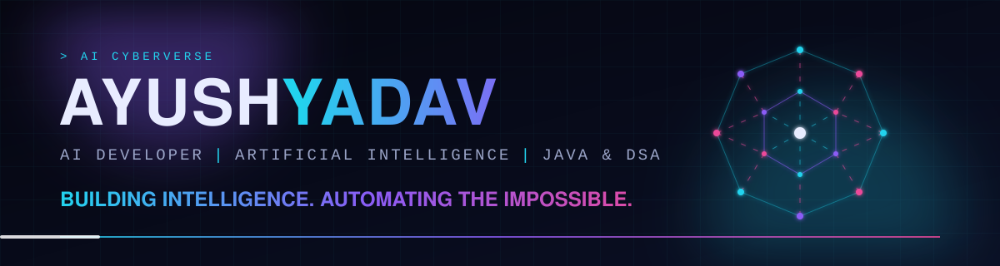
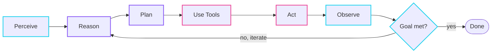
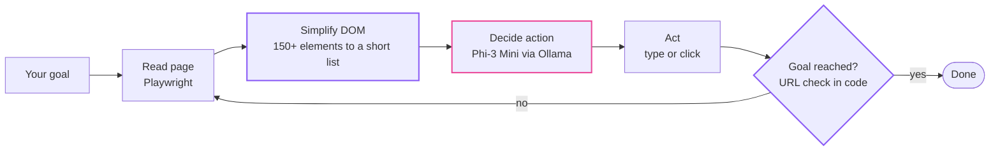
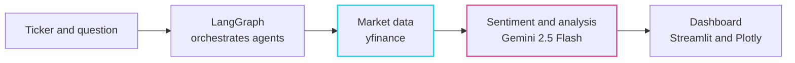
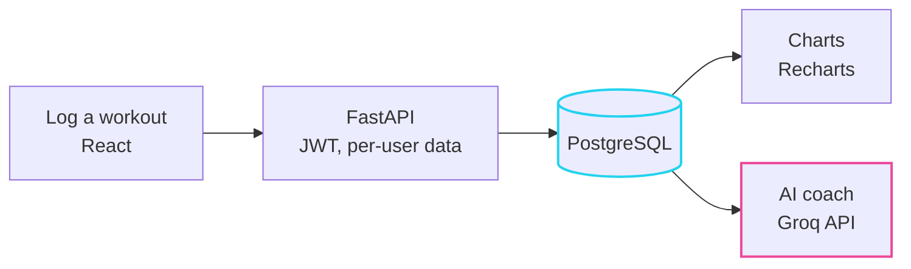

<div align="center">



<br />

**A futuristic, interactive portfolio built around one idea: show how AI agents work, not just list them.**

<br />

<a href="https://ai-cyberverse.vercel.app"></a>
<a href="https://github.com/ayush-yadav314"></a>
<a href="https://www.linkedin.com/in/ayush-yadav-634644321/"></a>


<br /><br />

<a href="#the-60-second-tour">Tour</a> ·
<a href="#the-agent-loop">Agent loop</a> ·
<a href="#featured-projects">Projects</a> ·
<a href="#engineering-decisions">Decisions</a> ·
<a href="#getting-started">Run it</a> ·
<a href="#customizing-the-content">Customize</a>

</div>

---

## The 60-second tour

Open the [live site](https://ai-cyberverse.vercel.app) and try these in order:

| # | Where | Try this |
|---|---|---|
| 1 | **Hero** | Move your mouse. The neural orb leans toward it. Hover the letters of the name. |
| 2 | **AI Universe** | Hover or tab through the seven stages of the agent loop. |
| 3 | **About** | Open the **DSA Lab**, pick a target and press Play to watch binary search shrink its range in step with the Java code. |
| 4 | **Projects** | Click the steps in a project's architecture flow, then open *Technical details and limitations*. |
| 5 | **Skills** | Hover **Python**, then a project pill, and watch the connections light up. |

> The terminal and the agent animations are **illustrative**. They are not a live AI system.

---

## Why this portfolio is different

- **It shows the thinking.** Every project has a problem, an approach, an architecture flow and its **limitations**.
- **It labels skills honestly.** A skill is *hands-on* only if I used it in a project. Everything else is *learning*.
- **It keeps data and design apart.** Projects, skills and the timeline live in plain data files.
- **It stays light.** A canvas particle sphere gives the 3D feel without a 3D library.

---

## At a glance

| Section | What it does |
|---|---|
| **Hero** | Animated name, a canvas neural orb that follows the pointer, an illustrative agent terminal |
| **AI Universe** | Interactive diagram of the agent lifecycle |
| **About** | Profile card, learning timeline, a "currently learning" list and the DSA Lab |
| **Projects** | Four featured case studies with clickable architecture flows |
| **Skills** | A constellation of skills grouped in clusters, tied to the projects that use them |
| **Contact** | Social links and an optional form that stays disabled until connected to a service |

Extras: scroll progress bar, magnetic buttons, tilt cards, cursor glow (mouse devices only) and a one-time boot loader.

---

## The agent loop

The site is organized around the lifecycle that separates an agent from a plain chatbot.



---

## Featured projects

| Project | What it is | Stack | Links |
|---|---|---|---|
| **Autonomous Browser Agent** | Plain-English goals turned into browser actions with a local LLM | Python, Ollama, Playwright, Streamlit | [GitHub](https://github.com/ayush-yadav314/autonomous-browser-agent) |
| **Multi-Agent Financial Research Assistant** | Multi-agent market research with live data and sentiment analysis | LangGraph, Gemini 2.5 Flash, yfinance, Plotly, Streamlit | [GitHub](https://github.com/ayush-yadav314/financial-agent-ai) · [Live demo](https://financial-agent-ai-a.streamlit.app/) |
| **PlateLog** | Full-stack workout tracker with progress charts and an AI coach | React, FastAPI, PostgreSQL, Groq API | [GitHub](https://github.com/ayush-yadav314/platelog) · [Live demo](https://platelog-alpha.vercel.app/) |
| **AI CYBERVERSE** | This portfolio | React, Vite, Motion, Canvas, SVG | [Live site](https://ai-cyberverse.vercel.app) |

<details>
<summary><b>Autonomous Browser Agent: how it works</b></summary>

<br />

A locally hosted Phi-3 Mini model (via Ollama) picks each next action, and Playwright carries it out in a real browser. The page is simplified from 150+ DOM elements to a short numbered list so a small model can decide reliably. Completion is checked in code by looking at the URL, not by asking the LLM.



**Limitations:** validated on DuckDuckGo, Wikipedia and Amazon.in only. A small local model may limit how complex a task it can handle. It needs Ollama and the model installed.

</details>

<details>
<summary><b>Multi-Agent Financial Research Assistant: how it works</b></summary>

<br />

LangGraph orchestrates the agents. Prices and metrics come from yfinance, and sentiment plus the written interpretation come from Gemini 2.5 Flash. The app separates **market data** from **AI-generated interpretation**.



**Limitations:** the analysis is AI-generated, can be wrong and is **not financial advice**. It depends on external data sources that can rate-limit. The free hosting sleeps when idle, so the first load can be slow.

</details>

<details>
<summary><b>PlateLog: how it works</b></summary>

<br />

A React app talks to a FastAPI backend with JWT authentication. Data lives in PostgreSQL in production and SQLite locally. Personal records are computed from history each time, and the AI coach (Groq API) only sees the workout log.



**Limitations:** free-tier hosting means cold starts. Workouts can be deleted but not yet edited. There are no automated tests or CI yet.

</details>

---

## Engineering decisions

| Decision | Why |
|---|---|
| **Canvas particle sphere instead of Three.js** | It gives the 3D feel while keeping the bundle small and the page fast. |
| **Content in data files** | Adding a project means adding one object. Layout code stays untouched. |
| **SVG for the agent loop and skills map** | Nodes are real DOM elements, so hover, focus and keyboard selection work. |
| **Native `<details>` for expandable sections** | Accessible by default, with no JavaScript needed. |
| **Hover, click and focus all select diagram nodes** | The diagrams work with a mouse, a keyboard and a touch screen. |
| **Global reduced-motion handling** | Motion's `reducedMotion` setting plus CSS media queries switch effects off. |
| **Animations are labelled illustrative** | A simulated animation should never pass as a running AI system. |

---

## Accessibility and performance

- Respects `prefers-reduced-motion` (animations, tilt, glow and the loader turn off)
- Keyboard navigation, visible focus rings, a skip link and `Esc` to close the mobile menu
- Semantic HTML with one `h1` and labelled landmarks
- The canvas animation pauses off-screen and uses fewer particles on small screens
- Touch devices skip the cursor glow and tilt effects
- SEO meta tags, Open Graph and Twitter card tags

---

## Tech stack

| Area | Tools |
|---|---|
| Framework | React, Vite |
| Styling | Plain CSS with design tokens (custom properties) |
| Animation | Motion for React, CSS animations |
| Visuals | HTML Canvas (neural orb), SVG (agent loop, skills map) |
| Icons | Lucide |
| Hosting | Vercel, auto-deployed from `main` |

**Design tokens** (all in `src/styles/tokens.css`): backgrounds `#05060f` and `#0a0f24`; accents cyan `#22d3ee`, blue `#3b82f6`, violet `#8b5cf6`, magenta `#ec4899`; highlights lime `#a3e635` and orange `#fb923c`; fonts Space Grotesk and JetBrains Mono.

---

## Getting started

You need a recent version of Node.js (developed with v24).

```bash
git clone https://github.com/ayush-yadav314/ai-cyberverse.git
cd ai-cyberverse
npm install
npm run dev
```

| Command | What it does |
|---|---|
| `npm run dev` | Start the dev server at `http://localhost:5173` |
| `npm run build` | Create a production build in `dist` |
| `npm run preview` | Preview the production build locally |
| `npm run lint` | Check the code with ESLint |

### Project structure

```
src/
  components/   Navbar, NeuralOrb, HeroTerminal, DsaLab, ProjectCard,
                Magnetic, Tilt, CursorGlow, ScrollProgress, Loader
  sections/     Hero, About, AIUniverse, Projects, Skills, Contact
  data/         projects, skills, timeline, agentStages, navLinks, binarySearch
  hooks/        useActiveSection
  styles/       tokens.css, global.css, effects.css
docs/           banner.svg
public/         favicon and static files
```

---

## Customizing the content

| To change... | Edit |
|---|---|
| Projects and their links | `src/data/projects.js` |
| Skills, and hands-on or learning status | `src/data/skills.js` |
| Learning timeline | `src/data/timeline.js` |
| Agent loop stage text | `src/data/agentStages.js` |
| Navigation items | `src/data/navLinks.js` |
| Colors and fonts | `src/styles/tokens.css` |
| Profile photo | `PHOTO` constant in `src/sections/About.jsx` |
| Project screenshots | `screenshot` field in `src/data/projects.js` |
| Contact form | `FORM_ENDPOINT` in `src/sections/Contact.jsx` |

---

## Honest notes and limitations

- The contact form stays **disabled** until it is connected to a form service, so it never pretends to send a message.
- Some project cards show generated artwork until real screenshots are added.
- The DSA Lab covers one algorithm (binary search) and is a walkthrough, not a record of problems solved.
- The agent loop and terminal are illustrative.

**Next up:** real screenshots, connecting the contact form, and more algorithms in the DSA Lab.

---

<div align="center">

**Ayush Yadav**<br />
B.Tech CSE (Artificial Intelligence) · Galgotias College of Engineering and Technology

[GitHub](https://github.com/ayush-yadav314) ·
[LinkedIn](https://www.linkedin.com/in/ayush-yadav-634644321/) ·
[LeetCode](https://leetcode.com/u/cseayush/)

<sub>Looking for AI, GenAI and Agentic AI internship opportunities.</sub>

</div>